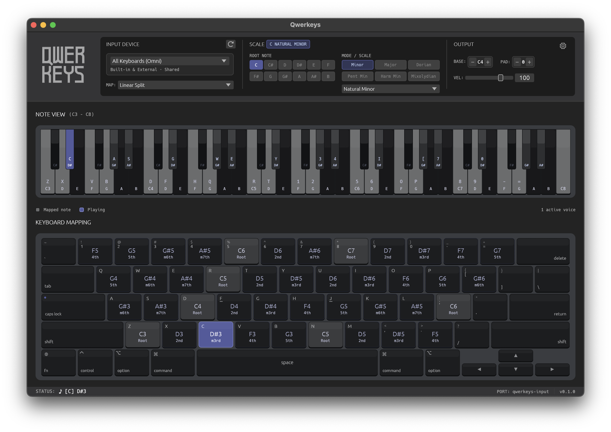

<table>
  <tr>
    <td width="200" align="center">
      
    </td>
    <td>
      <p>
        is a macOS app that converts your keyboard's keystrokes into MIDI notes in real time.
        It exposes a virtual MIDI input port, <b>qwerkeys-input</b>, that any DAW or MIDI-capable app
        can receive, including Logic Pro, Ableton Live, GarageBand, and FL Studio.
      </p>
    </td>
  </tr>
</table>

<div align="center">


</div>


## Features

- **Virtual MIDI port**: `qwerkeys-input` works in any DAW
- **Built-in scales**: pick a root and scale; every key you press is in tune
- **Left/right split**: map one keyboard to two hands with independent octaves per side
- **Layout presets**: Linear Split, Octave Stacked, or Linear Continuous
- **Dedicated keyboard mode**: target an external keyboard and its typing is suppressed, so it becomes purely a musical instrument

## Preview



## Installation

Download the latest prebuilt DMG from the [**releases page**](https://github.com/notenderdreams/qwerkeys/releases/latest):

1. Open the DMG and drag **Qwerkeys** into the **Applications** folder
2. First launch: right-click the app → **Open** (it's not notarized, so macOS may warn about an unidentified developer)
3. Grant the **Input Monitoring** and/or **Accessibility** permission when macOS asks — Qwerkeys opens with a short onboarding page explaining and linking to each permission; both can also be granted later via **System Settings → Privacy & Security**
4. Select **`qwerkeys-input`** as a MIDI input in your DAW and play

Requires macOS 11 or later (Apple Silicon).

## How it works

Qwerkeys sits between your keyboard and your DAW:

```text
Keystrokes → IOHID listener → scale mapping → qwerkeys-input (virtual MIDI port) → your DAW
```

1. A background IOHID listener captures raw keystrokes from the target keyboard.
2. Each key is mapped to a **scale degree**, not a fixed note.
3. The degree is combined with your chosen root note and scale to compute the MIDI note.
4. The note is sent out through the `qwerkeys-input` virtual MIDI port.

### Key mapping

Keys map to scale degrees rather than single notes. Choosing a key like **A** doesn't play a hardcoded note — it plays "the 6th degree of the currently selected scale in C." Change the root or scale and the same physical keys instantly play that new scale.

Since the layout is positional, muscle memory is stable: if you remember which key is *the root* and which keys sit next to it, that exact same finger pattern applies in every scale and on every key. What you learn on one scale transfers everywhere.

### Skipping out-of-scale notes

A 7-note scale doesn't fit evenly into a 12-note chromatic keyboard, so a naive "one key = one semitone step" mapping would frequently hit notes outside the scale. Qwerkeys skips out-of-scale notes entirely: each key advances to the next note *that actually exists in the selected scale*. The trade-off is that a physical key's pitch jumps by variable intervals (a whole step on the next key, then a minor third after the 7th degree), but the benefit is big: no wasted keys, every single key stays in tune, and you cover far more octaves and range with the same rows of keys.


## Development

Clone and run from source. Requires macOS and [Rust](https://rustup.rs).

```bash
git clone https://github.com/notenderdreams/qwerkeys.git
cd qwerkeys
cargo run --release
```

Useful during development:

```bash
cargo build --release          # optimized build → target/release/qwerkeys
cargo test                     # unit tests
scripts/bundle.sh v0.0.0-dev   # build a local .app + DMG for testing
```
